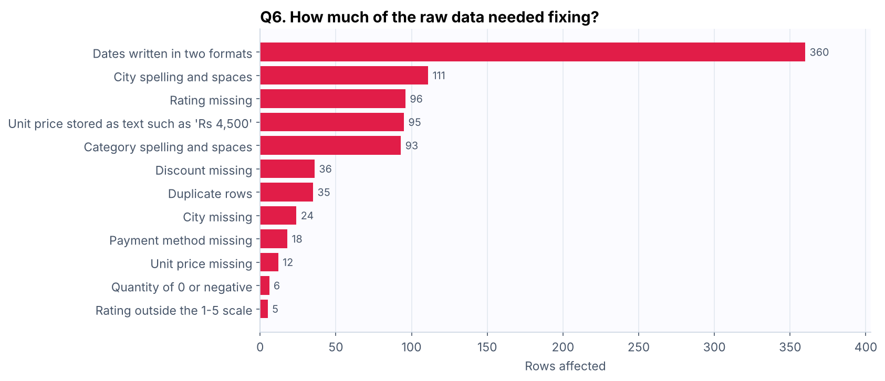
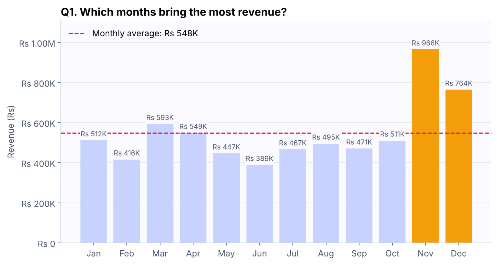
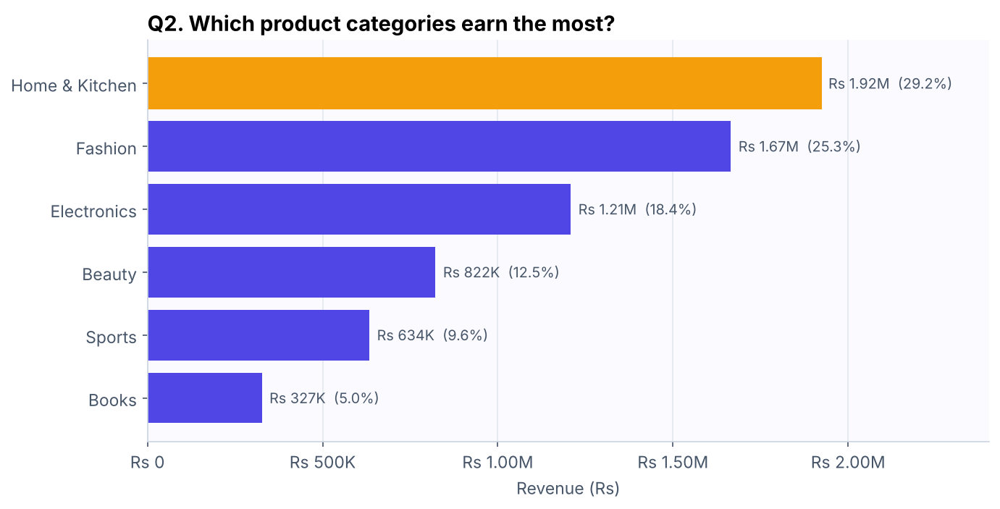
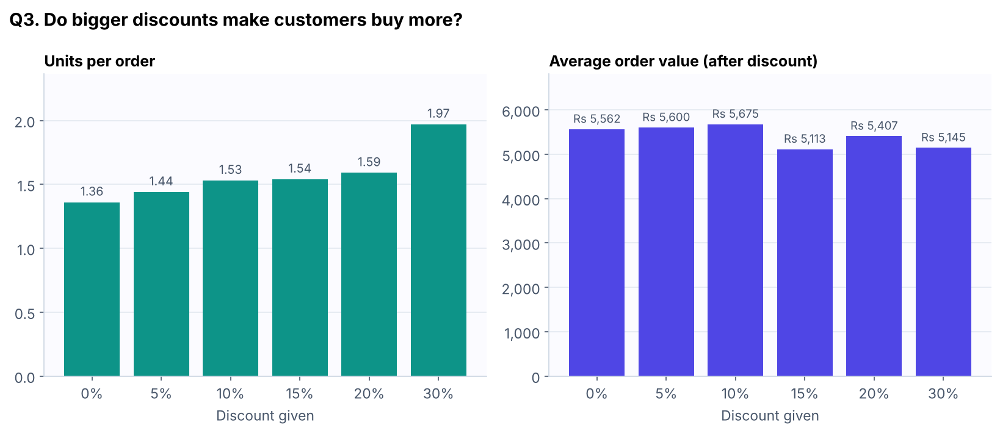
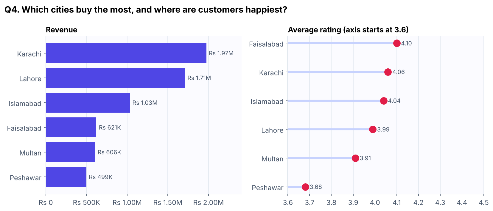
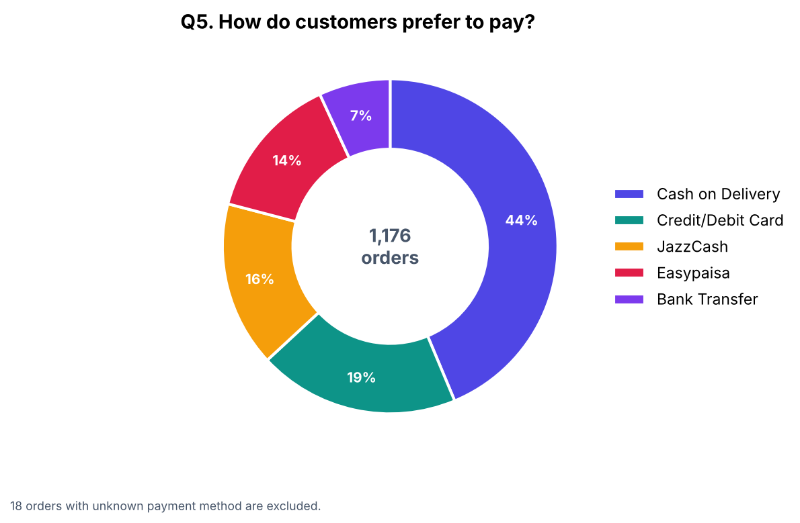

<p align="center">
  
</p>

<p align="center">
  
  
  
  
  
</p>

[](https://laiba-shehbaz.github.io/data-analysis-and-visualisation/data_analysis_run.html)

<h1 align="center"> ShopEase 2025 - Data Analysis and Visualisation</h1>

<p align="center">
  Load a messy CSV, clean it with documented decisions, calculate summary statistics, draw charts and report findings.<br>
  <b>Python Programming - Advanced Level | Task 2</b>
</p>

---

## 📑 Table of Contents
1. [Project at a Glance](#-project-at-a-glance)
2. [Dataset and Source](#-dataset-and-source)
3. [How to Run](#-how-to-run)
4. [Step 1 - Load and Inspect](#-step-1---load-and-inspect)
5. [Step 2 - Cleaning Decisions](#-step-2---cleaning-decisions)
6. [Step 3 - Summary Statistics](#-step-3---summary-statistics)
7. [Step 4 - Charts](#-step-4---charts)
8. [Step 5 - Conclusion: Three Key Findings](#-step-5---conclusion-three-key-findings)
9. [Project Structure](#-project-structure)
10. [Requirements Checklist](#-requirements-checklist)

---

## 🔭 Project at a Glance

| | |
|---|---|
| **Business** | ShopEase, a fictional online store in Pakistan |
| **Period** | January to December 2025 |
| **Raw data** | 1,235 rows x 11 columns |
| **Clean data** | 1,194 orders |
| **Revenue analysed** | Rs 6.58 million |
| **Customers** | 574 unique customers |
| **Average order value** | Rs 5,510 |

---

## 📦 Dataset and Source

**Source: self-created (synthetic) dataset.** It is generated by [`generate_dataset.py`](generate_dataset.py) with a fixed random seed (`42`), so everyone who runs it gets the same file. It does **not** contain real customers or real sales.

It is deliberately messy so the cleaning step has real work to do: duplicates, missing values, mixed date formats, prices stored as text, spelling mistakes and impossible values.

| Column | Meaning | Type after cleaning |
|---|---|---|
| `order_id` | Unique order number | text |
| `order_date` | Date of the order | datetime |
| `customer_id` | Customer code | text |
| `city` | Delivery city (6 cities) | text |
| `category` | Product category (6 categories) | text |
| `product` | Product name | text |
| `quantity` | Units in the order | integer |
| `unit_price` | Price of one unit (Rs) | number |
| `discount_pct` | Discount given (%) | number |
| `payment_method` | How the customer paid | text |
| `rating` | Customer rating from 1 to 5 | number |
| `revenue` | **New:** quantity x price x (1 - discount) | number |
| `month`, `month_name` | **New:** taken from the date | integer / text |

---

## 🚀 How to Run

```bash
pip install -r requirements.txt     # pandas, numpy, matplotlib

python generate_dataset.py          # optional: recreates data/sales_raw.csv
python analysis.py                  # runs the whole analysis
```

`analysis.py` creates the clean CSV, all tables, all six charts and the findings report in one run.

---

## 🔍 Step 1 - Load and Inspect

The CSV is loaded with `pd.read_csv()` and inspected with `info()`, `isna()`, `describe()` and `duplicated()`.
The full inspection is saved in [`outputs/data_inspection.txt`](outputs/data_inspection.txt).

| Column | Type found | Problem found |
|---|---|---|
| `order_date` | text | Two formats mixed together |
| `unit_price` | text | Some values look like `Rs 4,500` |
| `city` | text | 22 spellings for only 6 cities |
| `category` | text | 18 spellings for only 6 categories |
| `quantity` | integer | Contains `0` and `-1` |
| `rating` | decimal | Contains `0`, `9`, `10`; 97 missing |
| `discount_pct` | decimal | 37 missing |
| whole table | | 35 exact duplicate rows |

---

## 🧹 Step 2 - Cleaning Decisions

Every fix is written to [`outputs/cleaning_log.csv`](outputs/cleaning_log.csv) with the reason for the decision.

| Issue | Rows | Decision and reason |
|---|---:|---|
| Duplicate rows | 35 | **Removed.** An order must be counted once, otherwise revenue is inflated. |
| City spelling and spaces | 111 | **Standardised** (trim, lower-case, fix typos, title-case): 22 spellings became 6. |
| Category spelling and spaces | 93 | **Standardised:** 18 spellings became 6. |
| Dates in two formats | 360 | **Parsed** each format separately into one datetime column. |
| Price stored as text | 95 | **Converted** to numbers after removing `Rs` and commas. |
| Price missing | 12 | **Filled** with the median price of the same product. |
| Quantity 0 or negative | 6 | **Dropped.** The real quantity is unknown, and guessing would distort revenue. |
| Rating outside 1 to 5 | 5 | **Set to missing** rather than invent a value. |
| Discount missing | 36 | **Filled** with the median discount of the same month. |
| Rating missing | 96 | **Kept empty.** A rating is an opinion and cannot be invented. |
| City or payment method missing | 24 / 18 | **Labelled `Unknown`** so the sale still counts in revenue. |

**Result:** 1,235 raw rows became **1,194 clean rows**. The only missing values left are the ratings (101), and rating charts use only real reviews.

<p align="center"></p>

---

## 📊 Step 3 - Summary Statistics

More than five grouped results were calculated. All tables are saved in [`outputs/tables/`](outputs/tables).

**1. Overview**

| Measure | Value |
|---|---:|
| Orders | 1,194 |
| Units sold | 1,773 |
| Total revenue | Rs 6,579,000 |
| Average order value | Rs 5,510 |
| Median order value | Rs 4,728 |
| Average rating | 4.00 |

**2. Revenue by category**

| Category | Orders | Revenue (Rs) | Share | Avg rating |
|:---|---:|---:|---:|---:|
| Home & Kitchen | 239 | 1,922,303 | 29.2% | 3.90 |
| Fashion | 322 | 1,665,471 | 25.3% | 4.00 |
| Electronics | 202 | 1,208,461 | 18.4% | 3.74 |
| Beauty | 177 | 822,341 | 12.5% | 4.12 |
| Sports | 121 | 633,758 | 9.6% | 4.06 |
| Books | 133 | 326,668 | 5.0% | 4.32 |

**3. Revenue and rating by city**

| City | Orders | Revenue (Rs) | Avg order value (Rs) | Avg rating |
|:---|---:|---:|---:|---:|
| Karachi | 373 | 1,973,361 | 5,291 | 4.06 |
| Lahore | 306 | 1,710,203 | 5,589 | 3.99 |
| Islamabad | 192 | 1,033,901 | 5,385 | 4.04 |
| Faisalabad | 111 | 621,452 | 5,599 | 4.10 |
| Multan | 103 | 606,131 | 5,885 | 3.91 |
| Peshawar | 85 | 498,741 | 5,868 | 3.68 |

**4. Discount versus basket size**

| Discount | Orders | Avg units per order | Avg order value (Rs) |
|---:|---:|---:|---:|
| 0% | 476 | 1.36 | 5,562 |
| 5% | 148 | 1.44 | 5,600 |
| 10% | 235 | 1.53 | 5,675 |
| 15% | 84 | 1.54 | 5,113 |
| 20% | 184 | 1.59 | 5,407 |
| 30% | 67 | 1.97 | 5,145 |

**5. Payment methods:** Cash on Delivery 43.7%, Credit/Debit Card 19.4%, JazzCash 16.0%, Easypaisa 14.0%, Bank Transfer 6.9%.

**6. Repeat customers:** 63.2% of customers ordered at least twice, and they generate 81.8% of revenue.

**7. Best-selling products by revenue:** Air Fryer (Rs 822K), Sneakers (Rs 488K), Smart Watch (Rs 426K).

---

## 📈 Step 4 - Charts

Each chart answers one clear question.

### Q1. Which months bring the most revenue?
<p align="center"></p>

### Q2. Which product categories earn the most?
<p align="center"></p>

### Q3. Do bigger discounts make customers buy more?
<p align="center"></p>

### Q4. Which cities buy the most, and where are customers happiest?
<p align="center"></p>

### Q5. How do customers prefer to pay?
<p align="center"></p>

---

## 💡 Step 5 - Conclusion: Three Key Findings

> Full text with limitations: [`outputs/findings.md`](outputs/findings.md)

| # | Finding | Evidence | Suggested action |
|:-:|---|---|---|
| **1** | **Sales are strongly seasonal.** | November earned Rs 966K, about **1.9 times** the average of the other months. November and December bring **26%** of yearly revenue. | Stock up and advertise before the November sale. |
| **2** | **A few categories carry the business.** | Home & Kitchen (29.2%) and Fashion (25.3%) give **54%** of revenue. Fashion has the most orders, but each is worth Rs 5,172 against Rs 8,043 for Home & Kitchen. | Keep high-value categories in stock and promote them first. |
| **3** | **Discounts increase basket size, but not order value.** | Orders with 30% discount contain **1.97 units** versus 1.36 at 0%, yet the average order value is lower (Rs 5,145 versus Rs 5,562). | Use deep discounts selectively, for example to clear stock. |

**Extra observation:** Peshawar has the lowest average rating (3.68) and Faisalabad the highest (4.10), so delivery and service in Peshawar deserve a closer look.

**Limitations:** The data is synthetic, ratings exist for only 92% of orders, and the analysis shows association, not proof of cause (discounts and the November season overlap).

---

## 📁 Project Structure

```
Task2_Data_Analysis/
├── analysis.py                 # load -> inspect -> clean -> stats -> charts -> findings
├── generate_dataset.py         # creates the self-made messy dataset
├── requirements.txt
├── README.md
├── assets/                     # banner and icon
├── data/
│   ├── sales_raw.csv           # raw data (1,235 rows)
│   └── sales_clean.csv         # cleaned data (1,194 rows)
├── charts/                     # six PNG charts
└── outputs/
    ├── data_inspection.txt     # columns, types, missing values
    ├── cleaning_log.csv        # every cleaning decision
    ├── findings.md             # written conclusion
    ├── run_log.txt             # full terminal output of one run
    └── tables/                 # summary tables as CSV
```

---

## 🎯 Requirements Checklist

| Requirement | Status | Where |
|---|:---:|---|
| Load CSV with pandas, inspect columns and types | ✅ | Step 1, `outputs/data_inspection.txt` |
| Clean missing, duplicate, inconsistent values and explain | ✅ | Step 2, `outputs/cleaning_log.csv` |
| At least five summary statistics or grouped results | ✅ | Step 3 (seven result sets) |
| At least three charts answering clear questions | ✅ | Step 4 (six charts) |
| Short conclusion with three findings | ✅ | Step 5 |
| Dataset source included | ✅ | Self-created, `generate_dataset.py` |
| Script, charts and findings summary | ✅ | This folder |

---

**Author:** Laiba Shehbaz | Data Analysis and Visualisation
